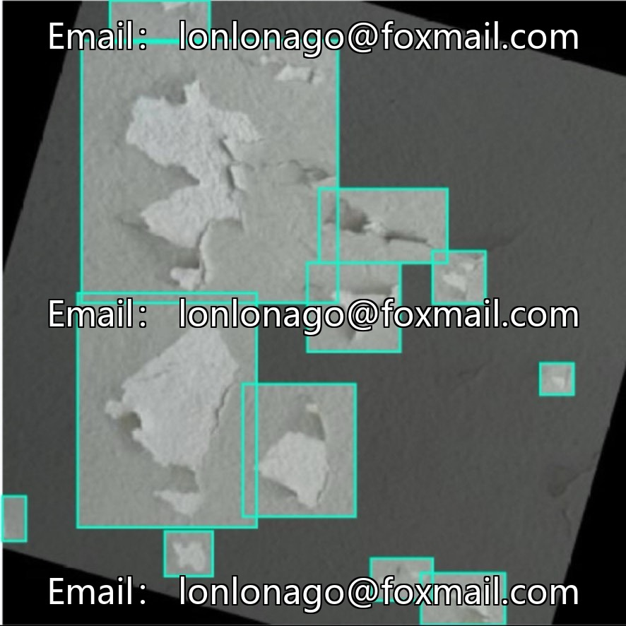
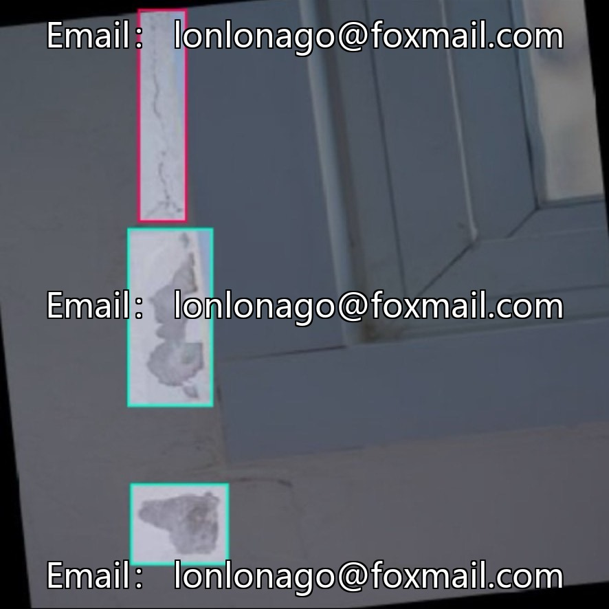
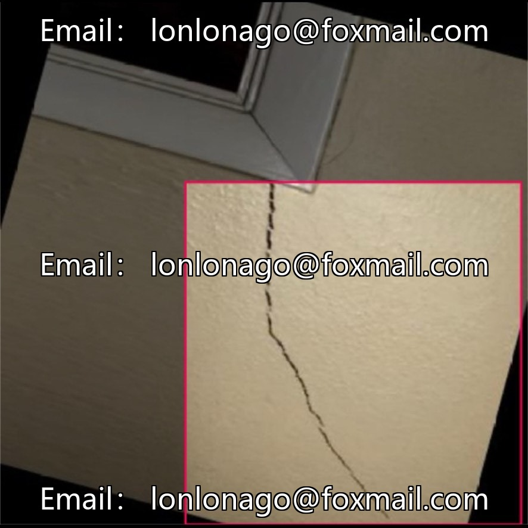
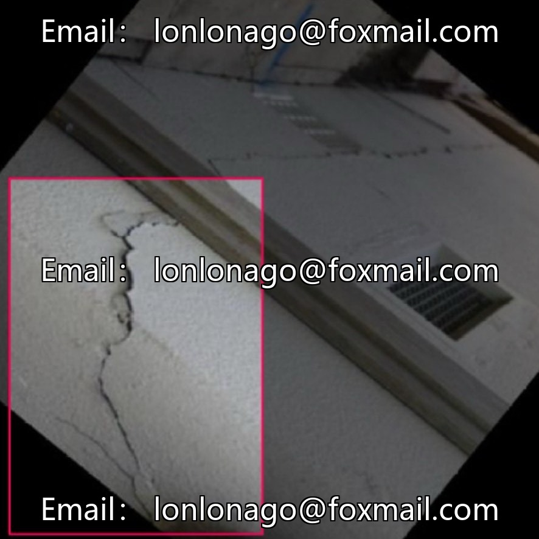

# Building facade defect detection dataset, issue 10381

## Body

Building facade defect detection dataset, issue 10381

Contains 1300 labeled images, 5 common diseases: cracks, mold, peeling paint, step-like cracks, water seepage. YOLO format, suitable for construction engineering inspection, quality testing, ancient architecture protection and other scenarios.

The data aligns with the actual inspection needs, with clear category definitions and unified annotation standards. It can be directly imported into mainstream object detection frameworks for model training.

Virtual materials, once sold, are non-refundable.
Interested friends, click "I want" to proceed.

## Images

## Payment

Here is a pay link on Stripe ( https://buy.stripe.com/3cs8yP7sY87d0vu9AB ). Please contact me lonlonago@foxmail.com after funding $89, and I will send you a complete data files , thank you!

